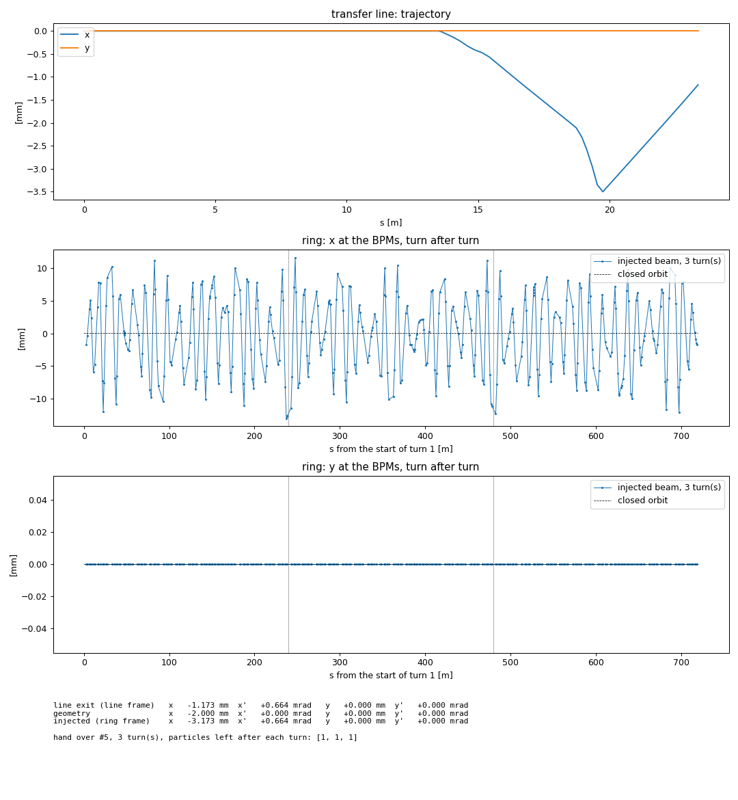

# BESSY II injection twin: transfer line and storage ring together

The transfer line twin (`../bessytl`) and the storage ring twin (`../bessyii`)
in one IOC, with the beam handed from the line to the ring.

## How they are put together

* **Two models, two submachines.** As in MML (where a transfer line is a
  submachine of its own, next to the storage ring), each keeps its devices,
  its lookup tables and its simulation engine: the ring computes its closed
  orbit and tunes, the line its trajectory and optics from the entering beam.
* **Stages.** As in LUME's `StagedModel`: the beam leaving the first model is
  the beam entering the second. Each element belongs to one model only, and
  the element where the beam is handed over belongs to the downstream one:
  the line ends at the septum exit (after `SEK2D1R`); the screen `FOMZ2D1R`
  and the kickers `KIK3D1R`, `KIK4D1R` are the ring's.
* **Hand over** (`coupler.py`): the centroid leaving the line (line frame),
  plus the injection geometry (the line's axis against the ring's axis at the
  septum exit), is the injected beam at the ring's `MSEPEXIT`. It is tracked
  from there for `n_turns` and read at the ring's BPMs. The ring lattice
  starts with a drift up to `MSEPEXIT`: the beam is moved back through it to
  the start of the lattice, where tracking begins.
* The hand over is recomputed whenever the line or the ring is recalculated
  (any supply change) or its settings change.

## Run

```bash
python src/dt4acc/custom_facility/bessyii_injection/run_bessyii_injection_twin.py
```

PVs, prefixed with `DT4ACC_PREFIX` (`<P>`, default: the user name):

| PVs | what |
|---|---|
| `<P>:Q1PDR:set`, `<P>:beam:orbit:x`, `<P>:ORBITCC:rdBpm`, ... | the storage ring, as the ring twin |
| `<P>:Q1PT:set`, `<P>:Q1MT:Cm:rdbk`, `<P>:FOMZ1T:x`, ... | the transfer line's supplies, magnets and monitors (up to the septum exit), machine names as in the transfer line twin; they do not clash with the ring's (line names end in T, ring names in R) |
| `<P>:TL:beam:orbit:*`, `<P>:TL:beam:twiss:*`, `<P>:TL:survey:*`, `<P>:TL:ORBITCC:*` | the transfer line's model PVs: the ring has PVs of the same names, so these are one level down |
| `<P>:INJ:geometry:{x,xp,y,yp}` | line axis against ring axis at the septum exit [m, rad] (writable) |
| `<P>:INJ:n_turns` | turns tracked in the ring (1 ... 256, writable) |
| `<P>:INJ:line_exit:{x,xp,y,yp}` | centroid leaving the line, line frame |
| `<P>:INJ:injected:{x,xp,y,yp}` | the injected beam, ring frame, at `MSEPEXIT` |
| `<P>:INJ:tbt:x`, `<P>:INJ:tbt:y`, `<P>:INJ:tbt:names` | position at the ring BPMs: turn 1 at all BPMs, then turn 2, ... [m] |
| `<P>:<bpm>:tbt:x`, `<P>:<bpm>:tbt:y` | one ring BPM, turn after turn [m] |
| `<P>:INJ:survived` | particles still there after each turn |
| `<P>:INJ:count` | hand overs computed so far |

## Try it

You need: dt4acc and dt4acc-lib (both `dev/feature/ring-tl-injection` or
later), lat2db (for the transfer line lattice), softioc and p4p (the twin),
EPICS base tools (`caget`, `caput`, `pvget`) and matplotlib (live plot).

**1. Start the twin** (one process: storage ring, transfer line, hand over).
On a shared network keep it on your machine:

```bash
export EPICS_CAS_INTF_ADDR_LIST=127.0.0.1 EPICS_CA_ADDR_LIST=127.0.0.1 EPICS_CA_AUTO_ADDR_LIST=NO
export EPICS_PVAS_INTF_ADDR_LIST=127.0.0.1 EPICS_PVA_ADDR_LIST=127.0.0.1 EPICS_PVA_AUTO_ADDR_LIST=NO
export DT4ACC_PREFIX=BI
python src/dt4acc/custom_facility/bessyii_injection/run_bessyii_injection_twin.py
```

It is up in a few seconds (`BI:INJ:count` answers). Use the same EPICS
variables in every terminal that talks to it.

**2. Watch it** (second terminal): redraws on every change.

```bash
python scripts/bessyii_injection/live_plot.py
```

1. transfer line: trajectory along the line
2. ring, x: the injected beam at the 123 ring BPMs, turn 1 from 0 to C
   (240 m), turn 2 from C to 2C, ...; dashed: the ring's closed orbit
3. ring, y: the same
4. the beam leaving the line, the geometry, the injected beam, particles left

**3. Change something** (third terminal), e.g.:

```bash
caput BI:H5PT:set 0.4          # transfer line steerer supply [A]
caput BI:INJ:geometry:x -0.002    # line axis against ring axis [m]
caput BI:INJ:n_turns 5            # turns tracked in the ring
caput BI:Q1PDR:set 207.85         # ring quadrupole supply [A] (was 205.79)
pvget BI:INJ:injected:x BI:INJ:survived
```

or let `scripts/bessyii_injection/demo.py` do these one by one (it says what to
expect, prints what came out, and puts everything back).

What to expect (as the twin is now: entering beam and geometry are
placeholders):

| change | transfer line | injected beam | ring BPMs (x rms per turn) |
|---|---|---|---|
| none | on axis | 0 | ~0.01 mm: the beam follows the closed orbit (it differs a little from the ideal axis in 6D) |
| `H5PT:set` 0.4 A | bends from H5MT on, -3.5 mm at 19.7 m | x -1.17 mm, x' +0.66 mrad | 6.0, 5.6 mm: betatron oscillation, a different pattern every turn |
| + `INJ:geometry:x` -2 mm, `xp` 0.1 mrad | unchanged | x -3.17 mm, x' +0.76 mrad | 7.4, 6.6, 6.8, 7.0, 6.6 mm (5 turns) |
| + `Q1PDR:set` +1 % | unchanged | unchanged | 7.8, 9.6, 13.4 mm, then NaN: the horizontal tune moves from .85 to ~.96, close to an integer; the oscillation grows and the beam is lost in turn 4 (`INJ:survived` 0) |
| steerer and geometry back to 0 | on axis | 0 | ~0.01 mm again |



Any supply of the line or the ring can be set the same way (lists:
`../bessytl/PV_LIST.md`, `../bessyii/PV_LIST.md`); `BI:<bpm>:tbt:x` gives one
ring BPM turn after turn.

## Check

```bash
pytest tests/bessyii_injection                                     # no EPICS
DT4ACC_PREFIX=<P> python scripts/bessyii_injection/check_twin.py  # against a running twin
```

Both compare with plain pyAT: the line tracked up to the septum exit, the
ring tracked from `MSEPEXIT` (the ring lattice rotated to start there).

## Not yet known (placeholders)

* **Injection geometry**: 0 (the line's axis on the ring's axis). Needs the
  septum position and angle against the ring axis.
* **Entering beam of the line**: see `../bessytl/README.md`.
* **One particle**: the centroid. A bunch (emittance, energy spread of the
  booster beam) and apertures (so that particles can be lost) are next.
* **Kickers**: `KIK1D1R` ... `KIK4D1R` are drifts in the ring lattice: no
  injection bump; the injected beam oscillates around the closed orbit.
